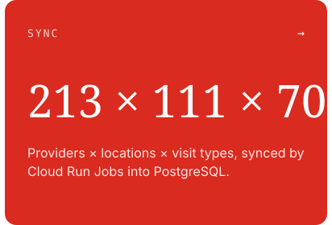
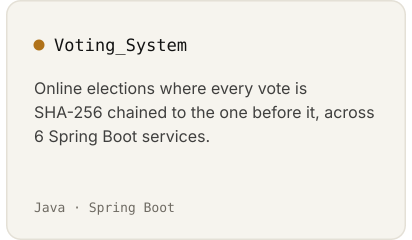
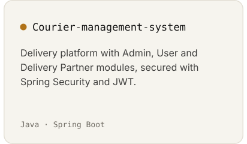
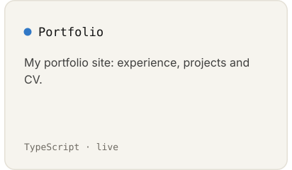
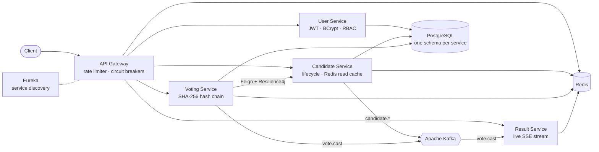

<div align="center">

<a href="https://vaibhavjain-portfolio.vercel.app/"></a>

<a href="#under-the-hood"></a><a href="#under-the-hood"></a><a href="#under-the-hood"></a>

<picture>
  <source media="(prefers-color-scheme: dark)" srcset="assets/cards/heading-building-dark.svg"/>
  <source media="(prefers-color-scheme: light)" srcset="assets/cards/heading-building-light.svg"/>
  
</picture>

<a href="https://github.com/Vaibhav0710/Voting_System"></a><a href="https://github.com/Vaibhav0710/Courier-management-system"></a><a href="https://vaibhavjain-portfolio.vercel.app/"></a>

[portfolio](https://vaibhavjain-portfolio.vercel.app/) &nbsp;/&nbsp; [linkedin](https://www.linkedin.com/in/-vaibhavjain/) &nbsp;/&nbsp; [resume](https://vaibhavjain-portfolio.vercel.app/Vaibhav_Jain_Java_Backend_Developer_CV.pdf) &nbsp;/&nbsp; [email](mailto:vaibhav.jain.careers@gmail.com)

</div>

## Under the hood

<details>
<summary><b>Work at IntelligentDX</b>: healthtech software for eye-care practices</summary>
<br/>

- Built a **treatment-plan booking API** that books every visit of a multi-appointment plan across up to **15 parallel lanes**, with atomic slot reservation, one audit row per appointment and 200/207/422 responses. In production since **September 2026**.
- Built **cancel and reschedule APIs** on an EHR with no native reschedule: book the new slot first, retry at timed offsets, return **HTTP 207** on partial success, full audit trail.
- Designed **background sync** (Cloud Scheduler → Cloud Run Jobs → PostgreSQL) for **213 providers × 111 locations × 70 visit types**, replacing slow or timing-out external calls with indexed database reads.
- Cut the **slot-search API** from about **2.7–3.6 s to 1.7–2.5 s** with a concurrent pager, and moved scheduling APIs to an EHR's **FHIR R4** API with unchanged API contracts.
- Designed an **AI rule-generation platform** around Claude with validation gates and a repair loop; prompt caching cut cost per generated rule by about **27–31%**.
- *Internship:* migrated **10 API read paths** across **5 C#/.NET microservices** from MongoDB to PostgreSQL in about **8 weeks**; 9 reached production with identical responses.

</details>

<details>
<summary><b>Voting System</b>: how every vote is chained to the one before it</summary>
<br/>

> An online election platform built so that **tampering with stored votes is detectable**. Each vote stores the SHA-256 hash of the vote before it, so editing or deleting any row breaks the chain, and a verification endpoint can find the break.



<table>
<tr>
<td width="50%" valign="top">

**How the chain works**

```java
// one row per election, SELECT … FOR UPDATE
ElectionChainHead head =
        chainHeadService.lockHead(electionId);

Vote vote = Vote.builder()
        .prevHash(head.getLastHash()) // "GENESIS" first
        /* user, candidate, election, time */
        .build();

// SHA-256(userId + candidateId + electionId
//         + epochSeconds + prevHash)
vote.setVoteHash(voteHasher.computeHash(vote));
head.setLastHash(vote.getVoteHash());
```

Locking the election's chain head makes concurrent votes link one after another. `POST /api/v1/votes/chain/validate/{electionId}` (admin only) recomputes every hash in the election and reports how many links are broken.

</td>
<td width="50%" valign="top">

**What stops a double vote**

- A Redis `voted:` key gives a fast rejection
- A unique constraint in the database is the final guard
- Idempotency keys make retries safe
- The gateway rate-limits each user with Redis token buckets
- Result Service skips vote ids it has already counted, so each vote counts once

</td>
</tr>
</table>

| Service | Responsibility | Repo |
|:--|:--|:--:|
| API Gateway | Routing, JWT check through User Service, role checks, CORS, Redis rate limiting, circuit breakers with fallbacks | [`Voting_Api-Gateway`](https://github.com/Vaibhav0710/Voting_Api-Gateway) |
| User Service | Registration, login, BCrypt, Voter/Admin roles | [`Voting_User_Service`](https://github.com/Vaibhav0710/Voting_User_Service) |
| Candidate Service | Candidate lifecycle (Active / Disqualified / Withdrawn), Redis read cache, Kafka events sent after commit | [`Voting_Candidate_Service`](https://github.com/Vaibhav0710/Voting_Candidate_Service) |
| Voting Service | Casting votes, hash chaining, verification, double-vote guard | [`Voting_Voting_Service`](https://github.com/Vaibhav0710/Voting_Voting_Service) |
| Result Service | Live counts from Kafka, kept in Redis, streamed over SSE | [`Voting_Result_Service`](https://github.com/Vaibhav0710/Voting_Result_Service) |
| Eureka Server | Service discovery | [`Voting_Eureka_Server`](https://github.com/Vaibhav0710/Voting_Eureka_Server) |

**Beyond the core features**

- **Resilience:** Resilience4j circuit breakers on every gateway route. If Candidate Service is down, Voting Service falls back to a Redis cache of candidate statuses it has already seen.
- **Observability:** Prometheus metrics, a Grafana dashboard, Zipkin tracing and JSON logs shipped to ELK.
- **Deployment:** a Dockerfile per service, a full Docker Compose stack, and Kubernetes manifests (Kustomize, ingress).
- **Testing:** JUnit tests in every service, a Testcontainers PostgreSQL test, JaCoCo coverage, scripted end-to-end and chaos runs, and Gatling load tests.

**Next:** finish the 10,000-vote load run (p95 under 500 ms, zero errors) and publish the results.

**Java 17 · Spring Boot 3.3 · Spring Cloud 2023 · Kafka · Redis · PostgreSQL · OpenFeign · Resilience4j · JJWT · Docker · Kubernetes** &nbsp;→&nbsp; [**Voting_System**](https://github.com/Vaibhav0710/Voting_System)

</details>

<details>
<summary><b>More projects</b>: six smaller builds, from a REST API to a farming robot</summary>
<br/>

| Project | What it is | Stack |
|:--|:--|:--|
| [Rent-A-Car](https://github.com/Vaibhav0710/Rent_A_Car) | A console car-rental system with entity, DAO and service layers. Admins manage the fleet and bookings; customers register and book. | `Java 17` `JDBC` `MySQL` `Maven` |
| [User Management REST API](https://github.com/Vaibhav0710/Backend-Developer-Intern-Assignment-Submission-Details) | A backend internship assignment: a CRUD REST API with routes, controller, model and DB config in separate modules, required-field checks and 400/404/500 error responses. | `Node.js` `Express` `MySQL` |
| [Pizza Shop](https://github.com/Vaibhav0710/Pizza-Shop) | A console ordering system with login, a categorised menu, a cart and an admin view of orders. | `Core Java` `JDBC` `MySQL` |
| [Autonomous Farming Robot](https://github.com/Vaibhav0710/DesignDevelopmentOfAutonomousFarmingWithPlanthealthIndicationSystem) | Final-year B.E. project: an IoT robot that monitors crop and soil health and detects leaf disease with image processing. | `ESP32` `Arduino` `OpenCV` `Python` `IoT sensors` |
| [Sudoku](https://github.com/Vaibhav0710/Sudoku_Game) | A desktop Sudoku with a puzzle generator, saved progress, and separate domain, persistence and UI layers | `Java` `JavaFX` |
| [Movie Finder](https://github.com/Vaibhav0710/Movie-Finder) | Search movies and view details from the OMDB API | `React` `JavaScript` |

The Courier Management System is a full-stack platform: Java 21, Spring Boot 3.4, Spring Data JPA, Spring Security with JWT, springdoc OpenAPI, MySQL and a React frontend.

</details>

<details>
<summary><b>Background and stack</b>: mechanical engineer turned backend developer</summary>
<br/>

- **Now:** Junior Software Developer at IntelligentDX, Pune. Intern from April 2025, full-time since November 2025.
- **Education:** B.E. Mechanical (MESCOE Pune, 2019–2023), then PG-DAC (C-DAC) at Sunbeam Pune.
- **At work:** Python (Flask), Node.js (Express), C#/.NET, PostgreSQL, Redis, BigQuery, Google Cloud.
- **In projects and training:** Java, Spring Boot, Spring Cloud, Kafka, Resilience4j, Docker, Kubernetes, Prometheus, Grafana.
- **Problem-solving:** [LeetCode solutions](https://github.com/Vaibhav0710/Leetcode-solution) · [90-day DSA plan](https://github.com/Vaibhav0710/Daily_DSA) · [CS50x](https://github.com/Vaibhav0710/CS50X) · [CS50P](https://github.com/Vaibhav0710/CS50P). LeetCode and TUF+ solutions sync automatically through LeetHub and TUFHub.
- **Certifications:** Java Full Stack LIVE Course (Spark 2.0) · Alpha: DSA with Java (Apna College) · Google Cloud Bootcamp (GeeksforGeeks) · LeetCode 100 Days Badge 2024.

</details>

<sub>The cards above are drawn by a small Python tool in [`tools/cards`](tools/cards).</sub>
