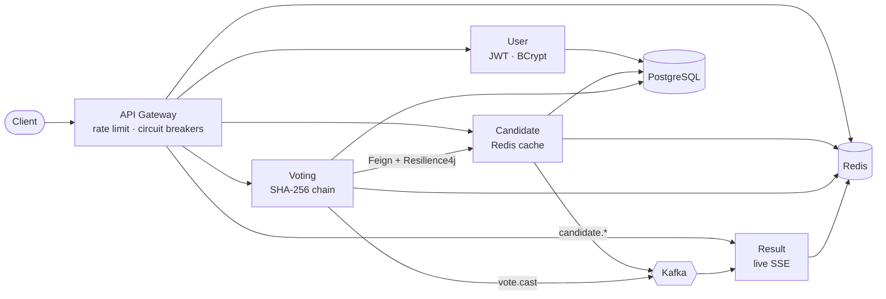
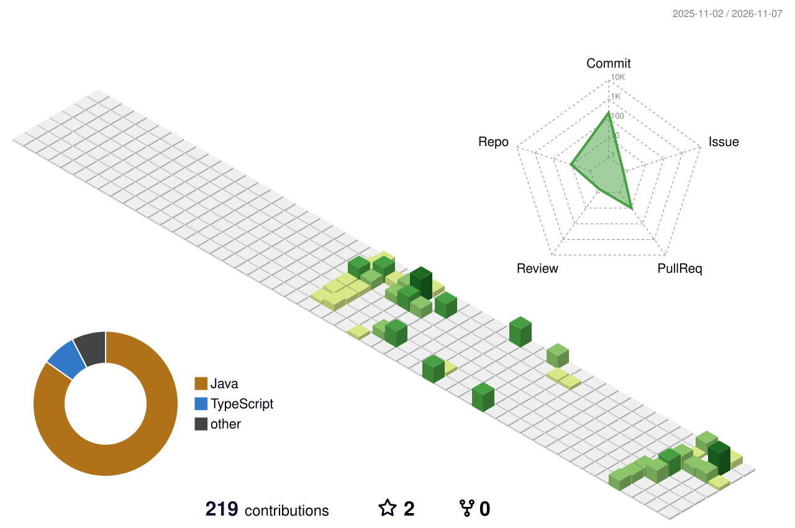

<div align="center">


<a href="https://vaibhavjain-portfolio.vercel.app/"></a>

<p>
  <a href="https://vaibhavjain-portfolio.vercel.app/"></a>
  <a href="https://www.linkedin.com/in/-vaibhavjain/"></a>
  <a href="https://vaibhavjain-portfolio.vercel.app/Vaibhav_Jain_Java_Backend_Developer_CV.pdf"></a>
  <a href="mailto:vaibhav.jain.careers@gmail.com"></a>
  
</p>

</div>

## 👋 About me

- 💼 **Junior Software Developer at IntelligentDX**, healthtech software for eye-care practices (intern from Apr 2025, full-time since Nov 2025)
- ⚙️ I build **booking and scheduling APIs on Google Cloud** with Python, Node.js, C#/.NET and PostgreSQL
- ☕ On the side I build **distributed systems in Java and Spring Boot**
- 🎓 B.E. Mechanical (MESCOE Pune, 2019–2023), then PG-DAC at C-DAC (Sunbeam Pune)
- 🌱 Next up: a 10,000-vote load test for my voting system and deeper system design
- 📍 Pune, India · 📫 vaibhav.jain.careers@gmail.com

## 🚀 What I've shipped

| | Work at IntelligentDX |
|:-:|:--|
| 📅 | **Treatment-plan booking API**: books every visit of a multi-appointment plan across up to **15 parallel lanes**, with atomic slot reservation and one audit row per appointment. Live since **Sep 2026**. |
| 🔁 | **Cancel & reschedule APIs** on an EHR with no native reschedule: book the new slot first, retry at timed offsets, **HTTP 207** on partial success. |
| ⏱️ | **Background sync** (Cloud Scheduler → Cloud Run Jobs → PostgreSQL) for **213 providers × 111 locations × 70 visit types**. |
| ⚡ | **Slot search** cut from **~2.7–3.6 s to 1.7–2.5 s** with a concurrent pager; scheduling APIs moved to **FHIR R4** with unchanged contracts. |
| 🤖 | **AI rule generation** around Claude with validation gates and a repair loop; prompt caching cut cost per rule by **~27–31%**. |
| 🧳 | *Internship:* **10 read paths** across **5 C#/.NET services** moved from MongoDB to PostgreSQL in ~8 weeks; 9 reached production. |

## 🗳️ Featured project: [Blockchain-Inspired Voting System](https://github.com/Vaibhav0710/Voting_System)

> Six Spring Boot services. Every vote stores the **SHA-256 hash of the previous vote**, so editing or deleting any row breaks the chain, and an admin endpoint finds the break.



<p align="center">
  
  
  
  
  
  
  
  
</p>

<details>
<summary><b>Services and how the chain works</b></summary>
<br/>

| Service | Responsibility |
|:--|:--|
| 🧭 [API Gateway](https://github.com/Vaibhav0710/Voting_Api-Gateway) | Routing, JWT checks, Redis rate limiting, circuit breakers |
| 👤 [User](https://github.com/Vaibhav0710/Voting_User_Service) | Registration, login, BCrypt, Voter/Admin roles |
| 🧑‍💼 [Candidate](https://github.com/Vaibhav0710/Voting_Candidate_Service) | Candidate lifecycle, Redis cache, Kafka events |
| 🗳️ [Voting](https://github.com/Vaibhav0710/Voting_Voting_Service) | Casting votes, hash chaining, double-vote guard |
| 📊 [Result](https://github.com/Vaibhav0710/Voting_Result_Service) | Live counts from Kafka, streamed over SSE |
| 📡 [Eureka](https://github.com/Vaibhav0710/Voting_Eureka_Server) | Service discovery |

```java
ElectionChainHead head = chainHeadService.lockHead(electionId); // SELECT … FOR UPDATE
Vote vote = Vote.builder().prevHash(head.getLastHash()) /* "GENESIS" first */ .build();
vote.setVoteHash(voteHasher.computeHash(vote)); // SHA-256(user + candidate + election + time + prevHash)
head.setLastHash(vote.getVoteHash());
```

Also: Prometheus + Grafana, Zipkin, ELK, Docker Compose, Kubernetes (Kustomize), JUnit, Testcontainers, Gatling load tests.

</details>

## 🧰 More projects

<table>
<tr>
<td width="50%" valign="top">

**📦 [Courier Management System](https://github.com/Vaibhav0710/Courier-management-system)**<br/>
Delivery platform with Admin, Customer and Delivery-Partner modules, JWT login and OpenAPI docs.<br/>
<sub>`Spring Boot 3.4` `JPA` `MySQL` `React`</sub>

</td>
<td width="50%" valign="top">

**🌐 [Portfolio](https://github.com/Vaibhav0710/Portfolio)** · [live](https://vaibhavjain-portfolio.vercel.app/)<br/>
My personal site, deployed on Vercel.<br/>
<sub>`Next.js` `TypeScript` `Tailwind`</sub>

</td>
</tr>
<tr>
<td width="50%" valign="top">

**🚗 [Rent-A-Car](https://github.com/Vaibhav0710/Rent_A_Car)**<br/>
Car-rental system with entity, DAO and service layers.<br/>
<sub>`Java 17` `JDBC` `MySQL`</sub>

</td>
<td width="50%" valign="top">

**👥 [User Management API](https://github.com/Vaibhav0710/Backend-Developer-Intern-Assignment-Submission-Details)**<br/>
CRUD REST API with validation and 400/404/500 handling.<br/>
<sub>`Node.js` `Express` `MySQL`</sub>

</td>
</tr>
<tr>
<td width="50%" valign="top">

**🌱 [Autonomous Farming Robot](https://github.com/Vaibhav0710/DesignDevelopmentOfAutonomousFarmingWithPlanthealthIndicationSystem)**<br/>
Final-year IoT robot that monitors soil and detects leaf disease.<br/>
<sub>`ESP32` `OpenCV` `Python`</sub>

</td>
<td width="50%" valign="top">

**🍕 [Pizza Shop](https://github.com/Vaibhav0710/Pizza-Shop)** · **🧩 [Sudoku](https://github.com/Vaibhav0710/Sudoku_Game)** · **🎬 [Movie Finder](https://github.com/Vaibhav0710/Movie-Finder)**<br/>
Console ordering app, JavaFX Sudoku and an OMDB movie search.<br/>
<sub>`Core Java` `JavaFX` `React`</sub>

</td>
</tr>
</table>

## 🛠️ Tech stack

<p align="center">
  <b>At work</b><br/><br/>
  
  <br/><br/>
  <b>Projects and tools</b><br/><br/>
  
</p>

## 📊 GitHub stats

<p align="center">
  <picture>
    <source media="(prefers-color-scheme: dark)" srcset="https://raw.githubusercontent.com/Vaibhav0710/Vaibhav0710/output/cards/github_dark/0-profile-details.svg"/>
    
  </picture>
</p>
<p align="center">
  <picture>
    <source media="(prefers-color-scheme: dark)" srcset="https://raw.githubusercontent.com/Vaibhav0710/Vaibhav0710/output/cards/github_dark/3-stats.svg"/>
    
  </picture>
  <picture>
    <source media="(prefers-color-scheme: dark)" srcset="https://raw.githubusercontent.com/Vaibhav0710/Vaibhav0710/output/cards/github_dark/2-most-commit-language.svg"/>
    
  </picture>
</p>
<p align="center">
  
</p>

<picture>
  <source media="(prefers-color-scheme: dark)" srcset="https://raw.githubusercontent.com/Vaibhav0710/Vaibhav0710/output/profile-night-view.svg"/>
  
</picture>

<picture>
  <source media="(prefers-color-scheme: dark)" srcset="https://raw.githubusercontent.com/Vaibhav0710/Vaibhav0710/output/github-snake-dark.svg"/>
  
</picture>

## 🧠 Problem solving

<p align="center">
  <a href="https://github.com/Vaibhav0710/Leetcode-solution"></a>
  <a href="https://github.com/Vaibhav0710/Daily_DSA"></a>
  <a href="https://github.com/Vaibhav0710/CS50X"></a>
  <a href="https://github.com/Vaibhav0710/CS50P"></a>
  <br/>
  <sub>📜 Java Full Stack LIVE (Spark 2.0) · Alpha: DSA with Java (Apna College) · Google Cloud Bootcamp (GeeksforGeeks) · LeetCode 100 Days Badge 2024</sub>
</p>

<div align="center">

**Open to conversations about backend engineering and distributed systems.** [Say hi →](mailto:vaibhav.jain.careers@gmail.com)


</div>
