<a href="https://vaibhavjain-portfolio.vercel.app/"></a>

<p align="center">
  <a href="https://vaibhavjain-portfolio.vercel.app/"></a>
  <a href="https://www.linkedin.com/in/-vaibhavjain/"></a>
  <a href="https://vaibhavjain-portfolio.vercel.app/Vaibhav_Jain_Java_Backend_Developer_CV.pdf"></a>
  <a href="mailto:vaibhav.jain.careers@gmail.com"></a>
  
</p>

<br/>

## ⚡ What I ship at IntelligentDX

<sub>Healthtech software for eye-care practices · intern from Apr 2025, full-time since Nov 2025</sub>


<details>
<summary><b>Read the details</b></summary>
<br/>

- **Treatment-plan booking API.** Books every visit of a multi-appointment plan across up to 15 parallel lanes, with atomic slot reservation, one audit row per appointment and 200/207/422 responses. In production since September 2026.
- **Cancel & reschedule APIs.** On an EHR with no native reschedule: book the new slot first, retry at timed offsets, return HTTP 207 on partial success, full audit trail.
- **Background sync.** Cloud Scheduler → Cloud Run Jobs → PostgreSQL for 213 providers × 111 locations × 70 visit types, replacing slow or timing-out external calls with indexed database reads.
- **Faster slot search.** About 2.7–3.6 s down to 1.7–2.5 s with a concurrent pager; moved scheduling APIs to an EHR's FHIR R4 API with unchanged API contracts.
- **AI rule generation.** A platform around Claude with validation gates and a repair loop; prompt caching cut cost per generated rule by about 27–31%.
- **Internship migration.** 10 API read paths across 5 C#/.NET microservices moved from MongoDB to PostgreSQL in about 8 weeks; 9 reached production with identical responses.

</details>

<br/>

## 🗳️ Flagship project

<a href="https://github.com/Vaibhav0710/Voting_System"></a>

<details>
<summary><b>Architecture</b></summary>
<br/>

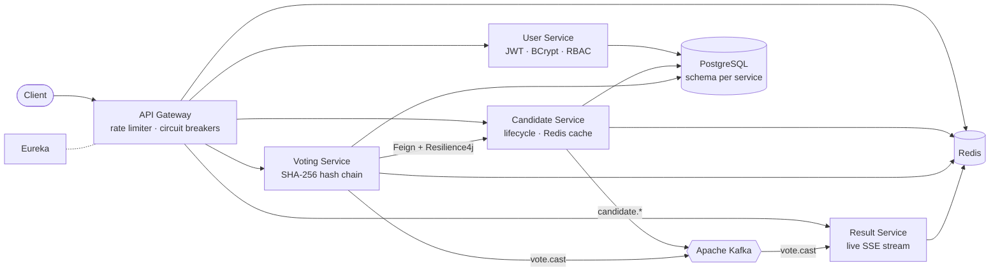

</details>

<details>
<summary><b>How the hash chain works</b></summary>
<br/>

```java
// one row per election, SELECT … FOR UPDATE
ElectionChainHead head = chainHeadService.lockHead(electionId);

Vote vote = Vote.builder()
        .prevHash(head.getLastHash())   // "GENESIS" for the first vote
        /* user, candidate, election, time */
        .build();

// SHA-256(userId + candidateId + electionId + epochSeconds + prevHash)
vote.setVoteHash(voteHasher.computeHash(vote));
head.setLastHash(vote.getVoteHash());
```

Locking the chain head makes concurrent votes link one after another. `POST /api/v1/votes/chain/validate/{electionId}` (admin only) recomputes every hash and reports how many links are broken.

**Double votes are stopped by:** a Redis `voted:` key for fast rejection · a unique DB constraint as the final guard · idempotency keys for safe retries · per-user Redis token-bucket rate limits · Result Service skipping vote ids it has already counted.

**Beyond the core:** Resilience4j circuit breakers with Redis fallbacks · Prometheus + Grafana, Zipkin, ELK · Docker Compose and Kubernetes (Kustomize, ingress) · JUnit, Testcontainers, JaCoCo, end-to-end and chaos scripts, Gatling load tests.

</details>

<details>
<summary><b>Service repos</b></summary>
<br/>

| Service | Responsibility | Repo |
|:--|:--|:--:|
| 🧭 API Gateway | Routing, JWT check, role checks, CORS, Redis rate limiting, circuit breakers | [`Voting_Api-Gateway`](https://github.com/Vaibhav0710/Voting_Api-Gateway) |
| 👤 User | Registration, login, BCrypt, Voter/Admin roles | [`Voting_User_Service`](https://github.com/Vaibhav0710/Voting_User_Service) |
| 🧑‍💼 Candidate | Lifecycle (Active / Disqualified / Withdrawn), Redis cache, Kafka events after commit | [`Voting_Candidate_Service`](https://github.com/Vaibhav0710/Voting_Candidate_Service) |
| 🗳️ Voting | Casting votes, hash chaining, verification, double-vote guard | [`Voting_Voting_Service`](https://github.com/Vaibhav0710/Voting_Voting_Service) |
| 📊 Result | Live counts from Kafka, kept in Redis, streamed over SSE | [`Voting_Result_Service`](https://github.com/Vaibhav0710/Voting_Result_Service) |
| 📡 Eureka | Service discovery | [`Voting_Eureka_Server`](https://github.com/Vaibhav0710/Voting_Eureka_Server) |

</details>

<br/>

## 🧰 More builds

<p align="center">
  <a href="https://github.com/Vaibhav0710/Courier-management-system"></a>
  <a href="https://github.com/Vaibhav0710/Portfolio"></a>
</p>
<p align="center">
  <a href="https://github.com/Vaibhav0710/Rent_A_Car"></a>
  <a href="https://github.com/Vaibhav0710/Backend-Developer-Intern-Assignment-Submission-Details"></a>
</p>
<p align="center">
  <a href="https://github.com/Vaibhav0710/DesignDevelopmentOfAutonomousFarmingWithPlanthealthIndicationSystem"></a>
  <a href="https://github.com/Vaibhav0710/Pizza-Shop"></a>
</p>

<p align="center"><sub>Also: <a href="https://github.com/Vaibhav0710/Sudoku_Game">🧩 Sudoku</a> (JavaFX) · <a href="https://github.com/Vaibhav0710/Movie-Finder">🎬 Movie Finder</a> (React)</sub></p>

<br/>

## 🛠️ Toolbox

<p align="center">
  <br/>
  <sub><b>AT WORK</b></sub>
</p>
<p align="center">
  <br/>
  <sub><b>IN PROJECTS</b></sub>
</p>

<br/>

## 🧠 Always learning

<p align="center">
  <a href="https://github.com/Vaibhav0710/Leetcode-solution"></a>
  <a href="https://github.com/Vaibhav0710/Daily_DSA"></a>
  <a href="https://github.com/Vaibhav0710/CS50X"></a>
  <a href="https://github.com/Vaibhav0710/CS50P"></a>
  <br/>
  <sub>Java Full Stack LIVE (Spark 2.0) · Alpha: DSA with Java (Apna College) · Google Cloud Bootcamp (GeeksforGeeks) · LeetCode 100 Days Badge 2024</sub>
</p>

<br/>

## 📈 Activity

<picture>
  <source media="(prefers-color-scheme: dark)" srcset="https://raw.githubusercontent.com/Vaibhav0710/Vaibhav0710/output/profile-night-view.svg" />
  <source media="(prefers-color-scheme: light)" srcset="https://raw.githubusercontent.com/Vaibhav0710/Vaibhav0710/output/profile-green-animate.svg" />
  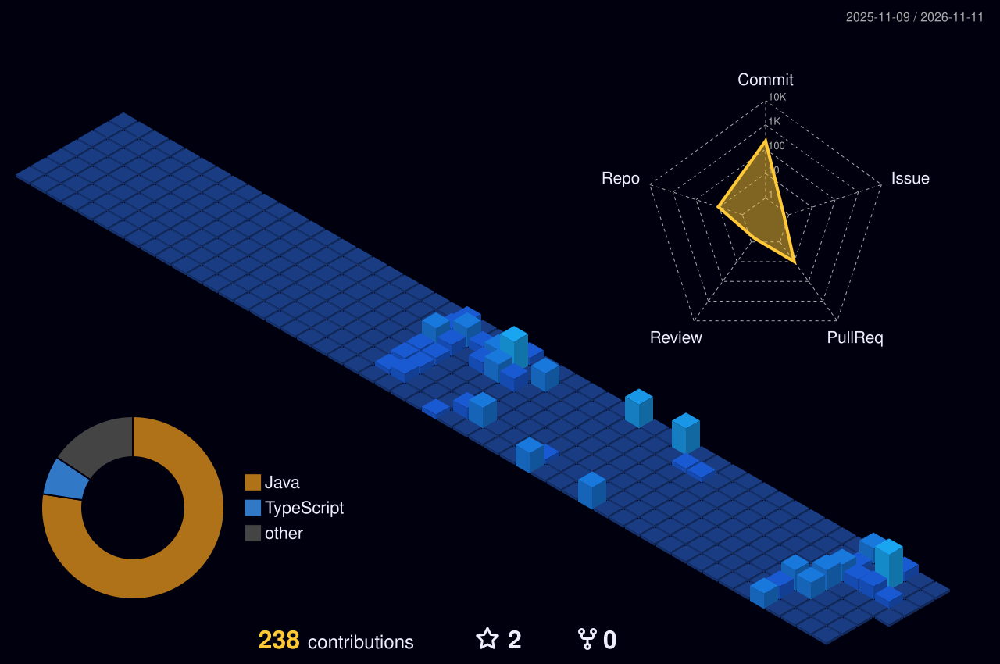
</picture>

<picture>
  <source media="(prefers-color-scheme: dark)" srcset="https://raw.githubusercontent.com/Vaibhav0710/Vaibhav0710/output/github-snake-dark.svg" />
  <source media="(prefers-color-scheme: light)" srcset="https://raw.githubusercontent.com/Vaibhav0710/Vaibhav0710/output/github-snake.svg" />
  
</picture>

<br/><br/>

<a href="mailto:vaibhav.jain.careers@gmail.com"></a>

<!-- Graphics in assets/ are generated by scripts/build_assets.py. Edit the text there and re-run it. -->
