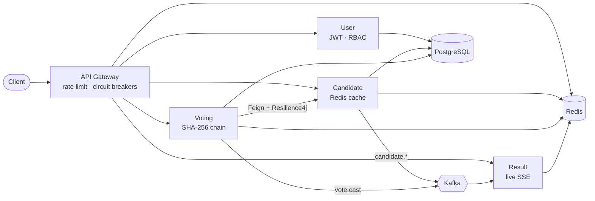

<div align="center">

# Hi, I'm Vaibhav 👋

**Backend developer building booking & scheduling APIs on Google Cloud**<br/>
<sub>Junior Software Developer @ IntelligentDX · Pune, India 🇮🇳 · Mechanical engineer turned backend developer</sub>

<br/>

[](https://vaibhavjain-portfolio.vercel.app/)
[](https://www.linkedin.com/in/-vaibhavjain/)
[](https://vaibhavjain-portfolio.vercel.app/Vaibhav_Jain_Java_Backend_Developer_CV.pdf)
[](mailto:vaibhav.jain.careers@gmail.com)
[](https://github.com/Vaibhav0710)

</div>

<br/>

I build backend systems for healthtech software used by eye-care practices: APIs that book multi-visit treatment plans, sync thousands of provider schedules, and keep partial failures honest. Outside work, I build distributed systems in **Java + Spring** to go deeper on consistency, resilience and observability.

> [!NOTE]
> **Open to conversations** about backend engineering, distributed systems and interesting problems. [Say hi →](mailto:vaibhav.jain.careers@gmail.com)

<br/>

## 🟢 Now

```yaml
shipping:  Booking & scheduling APIs on Google Cloud (Python · Node.js · C#/.NET · PostgreSQL)
building:  A tamper-evident voting platform — 6 Spring Boot services, every vote hash-chained
next:      10,000-vote load run (p95 < 500 ms, zero errors) + deeper system design
journey:   B.E. Mechanical (MESCOE Pune, 2019–23) → PG-DAC (C-DAC, Sunbeam Pune) → backend dev
```

<br/>

## 💼 Impact at IntelligentDX

<sub>Intern from Apr 2025 · full-time since Nov 2025</sub>

| | |
|:--|:--|
| 📅 **Treatment-plan booking** | Books every visit of a multi-appointment plan across up to **15 parallel lanes** — atomic slot reservation, one audit row per appointment, 200/207/422 responses. **In production since Sep 2026.** |
| 🔁 **Cancel & reschedule** | On an EHR with no native reschedule: book the new slot first, retry at timed offsets, **HTTP 207** on partial success, full audit trail. |
| ⏱️ **Background sync** | Cloud Scheduler → Cloud Run Jobs → PostgreSQL for **213 providers × 111 locations × 70 visit types**, replacing slow external calls with indexed reads. |
| ⚡ **Faster slot search** | **~2.7–3.6 s → 1.7–2.5 s** with a concurrent pager; migrated scheduling APIs to **FHIR R4** with unchanged contracts. |
| 🤖 **AI rule generation** | Platform around Claude with validation gates and a repair loop; prompt caching cut cost per rule by **~27–31%**. |
| 🧳 **Internship migration** | **10 read paths** across **5 C#/.NET microservices** moved from MongoDB to PostgreSQL in ~**8 weeks**; 9 reached production with identical responses. |

<br/>

## 🗳️ Featured: Blockchain-Inspired Voting System

> An online election platform where **tampering with stored votes is detectable**. Each vote stores the SHA-256 hash of the previous vote, so editing or deleting any row breaks the chain — and an admin endpoint finds the break.



**Highlights:** row-locked chain head per election (`SELECT … FOR UPDATE`) · Redis + DB-constraint double-vote guard · idempotency keys · Resilience4j fallbacks · Prometheus/Grafana, Zipkin, ELK · Docker Compose + Kubernetes (Kustomize) · JUnit, Testcontainers, JaCoCo, Gatling

<details>
<summary><b>How the hash chain works</b></summary>
<br/>

```java
// one row per election, SELECT … FOR UPDATE
ElectionChainHead head = chainHeadService.lockHead(electionId);

Vote vote = Vote.builder()
        .prevHash(head.getLastHash())   // "GENESIS" for the first vote
        /* user, candidate, election, time */
        .build();

// SHA-256(userId + candidateId + electionId + epochSeconds + prevHash)
vote.setVoteHash(voteHasher.computeHash(vote));
head.setLastHash(vote.getVoteHash());
```

Locking the chain head makes concurrent votes link one after another. `POST /api/v1/votes/chain/validate/{electionId}` (admin only) recomputes every hash and reports how many links are broken.

</details>

<details>
<summary><b>Services & repos</b></summary>
<br/>

| Service | Responsibility | Repo |
|:--|:--|:--:|
| 🧭 API Gateway | Routing, JWT check, role checks, CORS, Redis rate limiting, circuit breakers | [`Voting_Api-Gateway`](https://github.com/Vaibhav0710/Voting_Api-Gateway) |
| 👤 User | Registration, login, BCrypt, Voter/Admin roles | [`Voting_User_Service`](https://github.com/Vaibhav0710/Voting_User_Service) |
| 🧑‍💼 Candidate | Lifecycle (Active / Disqualified / Withdrawn), Redis cache, Kafka events after commit | [`Voting_Candidate_Service`](https://github.com/Vaibhav0710/Voting_Candidate_Service) |
| 🗳️ Voting | Casting votes, hash chaining, verification, double-vote guard | [`Voting_Voting_Service`](https://github.com/Vaibhav0710/Voting_Voting_Service) |
| 📊 Result | Live counts from Kafka, kept in Redis, streamed over SSE | [`Voting_Result_Service`](https://github.com/Vaibhav0710/Voting_Result_Service) |
| 📡 Eureka | Service discovery | [`Voting_Eureka_Server`](https://github.com/Vaibhav0710/Voting_Eureka_Server) |

</details>

<sub>Java 17 · Spring Boot 3.3 · Spring Cloud 2023 · Kafka · Redis · PostgreSQL · OpenFeign · Resilience4j · Docker · Kubernetes</sub> &nbsp;→&nbsp; [**Voting_System**](https://github.com/Vaibhav0710/Voting_System)

<br/>

## 🧰 More projects

| Project | What it is | Stack |
|:--|:--|:--|
| 🌐 [**Portfolio**](https://github.com/Vaibhav0710/Portfolio) · [live](https://vaibhavjain-portfolio.vercel.app/) | My personal site, deployed on Vercel | `Next.js` `TypeScript` `Tailwind` |
| 📦 [**Courier Management**](https://github.com/Vaibhav0710/Courier-management-system) | Full-stack delivery platform with Admin, Customer and Delivery-Partner modules, JWT, OpenAPI docs | `Spring Boot 3.4` `JPA` `MySQL` `React` |
| 🚗 [**Rent-A-Car**](https://github.com/Vaibhav0710/Rent_A_Car) | Console car rental with entity / DAO / service layers | `Java 17` `JDBC` `MySQL` |
| 👥 [**User Management API**](https://github.com/Vaibhav0710/Backend-Developer-Intern-Assignment-Submission-Details) | Modular CRUD REST API with validation and 400/404/500 handling | `Node.js` `Express` `MySQL` |
| 🍕 [**Pizza Shop**](https://github.com/Vaibhav0710/Pizza-Shop) | Console ordering system with cart and admin order view | `Core Java` `JDBC` `MySQL` |
| 🌱 [**Autonomous Farming Robot**](https://github.com/Vaibhav0710/DesignDevelopmentOfAutonomousFarmingWithPlanthealthIndicationSystem) | Final-year IoT robot that monitors soil and detects leaf disease | `ESP32` `OpenCV` `Python` |
| 🧩 [**Sudoku**](https://github.com/Vaibhav0710/Sudoku_Game) | Desktop Sudoku with generator and saved progress | `Java` `JavaFX` |
| 🎬 [**Movie Finder**](https://github.com/Vaibhav0710/Movie-Finder) | Movie search on the OMDB API | `React` |

<br/>

## 🛠️ Stack

<table>
<tr><td><b>At work</b></td><td></td></tr>
<tr><td><b>Projects</b></td><td></td></tr>
<tr><td><b>Tools</b></td><td></td></tr>
</table>

<br/>

## 🧠 Learning & problem-solving

[](https://github.com/Vaibhav0710/Leetcode-solution)
[](https://github.com/Vaibhav0710/Daily_DSA)
[](https://github.com/Vaibhav0710/CS50X)
[](https://github.com/Vaibhav0710/CS50P)

<sub>LeetCode and TUF+ solutions sync automatically via LeetHub and TUFHub.<br/>
📜 Java Full Stack LIVE (Spark 2.0) · Alpha: DSA with Java (Apna College) · Google Cloud Bootcamp (GeeksforGeeks) · LeetCode 100 Days Badge 2024</sub>

<br/>

## 📊 Activity

<picture>
  <source media="(prefers-color-scheme: dark)" srcset="https://raw.githubusercontent.com/Vaibhav0710/Vaibhav0710/output/profile-night-view.svg" />
  <source media="(prefers-color-scheme: light)" srcset="https://raw.githubusercontent.com/Vaibhav0710/Vaibhav0710/output/profile-green-animate.svg" />
  
</picture>

<picture>
  <source media="(prefers-color-scheme: dark)" srcset="https://raw.githubusercontent.com/Vaibhav0710/Vaibhav0710/output/github-snake-dark.svg" />
  <source media="(prefers-color-scheme: light)" srcset="https://raw.githubusercontent.com/Vaibhav0710/Vaibhav0710/output/github-snake.svg" />
  
</picture>

<br/>

<div align="center">
<sub><i>"Make it work, make it right, make it fast" — in that order.</i></sub>
</div>
