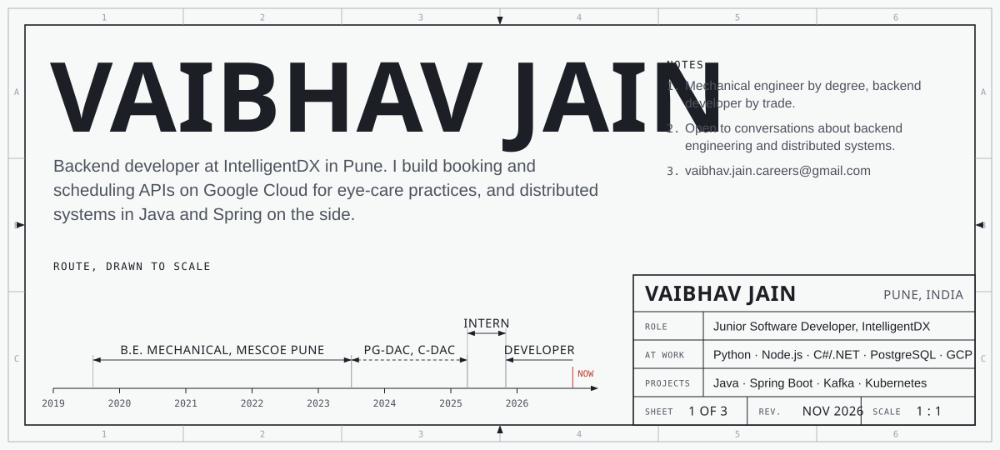
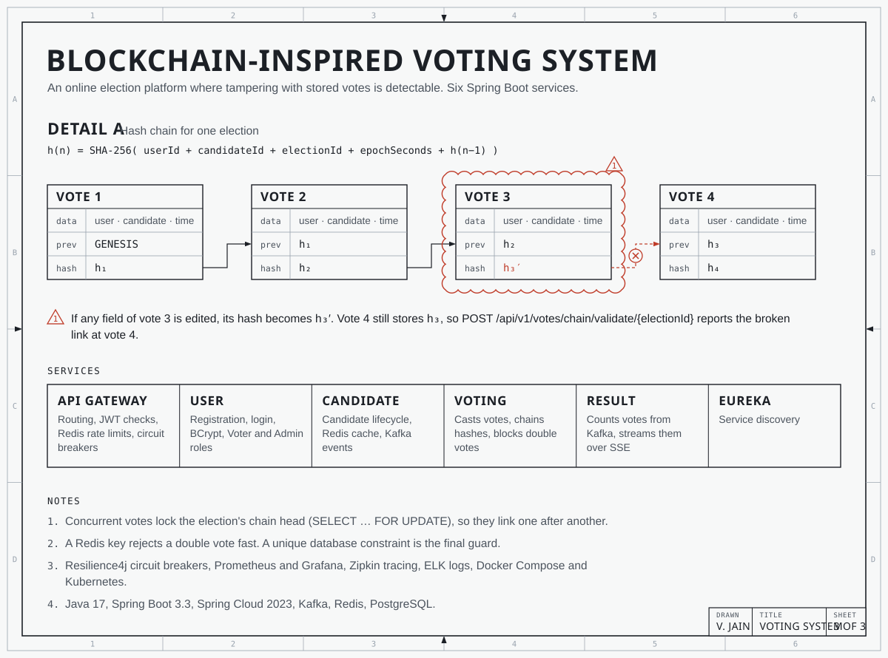

<picture>
  <source media="(prefers-color-scheme: dark)" srcset="assets/sheet-profile-dark.svg" />
  
</picture>

[Portfolio](https://vaibhavjain-portfolio.vercel.app/) · [LinkedIn](https://www.linkedin.com/in/-vaibhavjain/) · [Resume (PDF)](https://vaibhavjain-portfolio.vercel.app/Vaibhav_Jain_Java_Backend_Developer_CV.pdf) · [vaibhav.jain.careers@gmail.com](mailto:vaibhav.jain.careers@gmail.com)

## Work

<picture>
  <source media="(prefers-color-scheme: dark)" srcset="assets/sheet-parts-dark.svg" />
  
</picture>

Same list as text

1. **Treatment-plan booking API.** Books every visit of a multi-appointment plan across up to 15 parallel lanes, with atomic slot reservation, one audit row per appointment and 200/207/422 responses. In production since September 2026.
2. **Cancel and reschedule APIs.** Built on an EHR with no native reschedule: book the new slot first, retry at timed offsets, return HTTP 207 on partial success, keep a full audit trail.
3. **Background sync.** Cloud Scheduler to Cloud Run Jobs to PostgreSQL for 213 providers × 111 locations × 70 visit types, replacing slow or timing-out external calls with indexed reads.
4. **Slot-search API.** About 2.7–3.6 s down to 1.7–2.5 s with a concurrent pager. Scheduling APIs moved to the EHR's FHIR R4 API with unchanged contracts.
5. **AI rule generation.** A platform around Claude with validation gates and a repair loop. Prompt caching cut cost per generated rule by about 27–31%.
6. **MongoDB to PostgreSQL (internship).** 10 API read paths across 5 C#/.NET microservices in about 8 weeks. 9 reached production with identical responses.

## Voting system

<a href="https://github.com/Vaibhav0710/Voting_System">
<picture>
  <source media="(prefers-color-scheme: dark)" srcset="assets/sheet-voting-dark.svg" />
  
</picture>
</a>

Code: [Voting_System](https://github.com/Vaibhav0710/Voting_System) · services: [gateway](https://github.com/Vaibhav0710/Voting_Api-Gateway), [user](https://github.com/Vaibhav0710/Voting_User_Service), [candidate](https://github.com/Vaibhav0710/Voting_Candidate_Service), [voting](https://github.com/Vaibhav0710/Voting_Voting_Service), [result](https://github.com/Vaibhav0710/Voting_Result_Service), [eureka](https://github.com/Vaibhav0710/Voting_Eureka_Server)

Architecture

## Other projects

| Project | What it is | Stack |
|:--|:--|:--|
| [Courier Management System](https://github.com/Vaibhav0710/Courier-management-system) | Delivery platform with Admin, Customer and Delivery-Partner modules, JWT login and OpenAPI docs | Java 21, Spring Boot 3.4, JPA, MySQL, React |
| [Portfolio](https://github.com/Vaibhav0710/Portfolio) | My site, [live on Vercel](https://vaibhavjain-portfolio.vercel.app/) | Next.js, TypeScript, Tailwind |
| [Rent-A-Car](https://github.com/Vaibhav0710/Rent_A_Car) | Console car rental with entity, DAO and service layers | Java 17, JDBC, MySQL |
| [User Management API](https://github.com/Vaibhav0710/Backend-Developer-Intern-Assignment-Submission-Details) | CRUD REST API with field checks and 400/404/500 errors | Node.js, Express, MySQL |
| [Pizza Shop](https://github.com/Vaibhav0710/Pizza-Shop) | Console ordering with a menu, a cart and an admin view | Core Java, JDBC, MySQL |
| [Autonomous Farming Robot](https://github.com/Vaibhav0710/DesignDevelopmentOfAutonomousFarmingWithPlanthealthIndicationSystem) | Final-year B.E. project: IoT robot that checks soil and detects leaf disease | ESP32, Arduino, OpenCV, Python |
| [Sudoku](https://github.com/Vaibhav0710/Sudoku_Game) | Desktop Sudoku with a generator and saved progress | Java, JavaFX |
| [Movie Finder](https://github.com/Vaibhav0710/Movie-Finder) | Movie search on the OMDB API | React |

## Tools

**At work:** Python (Flask), Node.js (Express), C#/.NET, PostgreSQL, Redis, BigQuery, Google Cloud 
**In projects:** Java, Spring Boot, Spring Cloud, Kafka, Resilience4j, Docker, Kubernetes, Prometheus, Grafana

## Practice

[LeetCode solutions](https://github.com/Vaibhav0710/Leetcode-solution) and a [90-day DSA plan](https://github.com/Vaibhav0710/Daily_DSA), synced through LeetHub and TUFHub. Coursework in [CS50x](https://github.com/Vaibhav0710/CS50X) and [CS50P](https://github.com/Vaibhav0710/CS50P). 
Certificates: Java Full Stack LIVE (Spark 2.0), Alpha: DSA with Java (Apna College), Google Cloud Bootcamp (GeeksforGeeks), LeetCode 100 Days Badge 2024.

## Activity

<picture>
  <source media="(prefers-color-scheme: dark)" srcset="https://raw.githubusercontent.com/Vaibhav0710/Vaibhav0710/output/sheet-activity-dark.svg" />
  
</picture>

<!-- Sheets 1–3 in assets/ come from scripts/build_sheets.py. Sheet 4 is drawn by scripts/build_activity.py in the workflow and published to the output branch. -->
